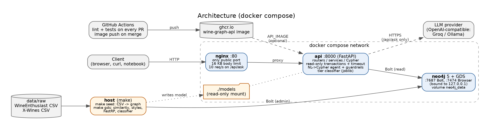
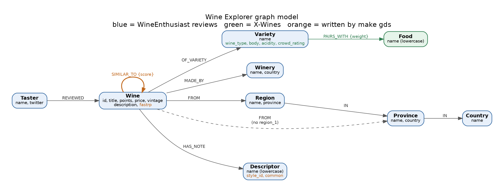
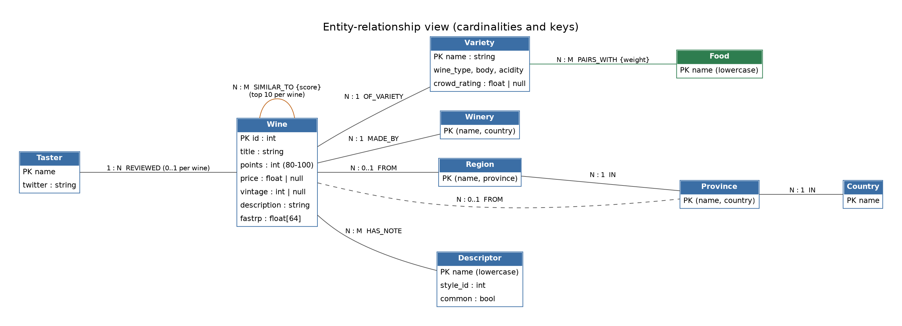
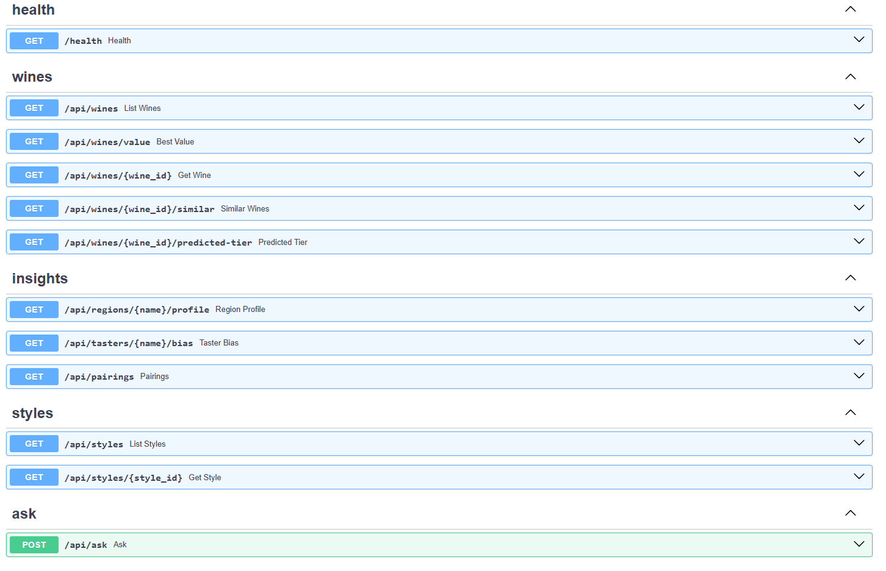
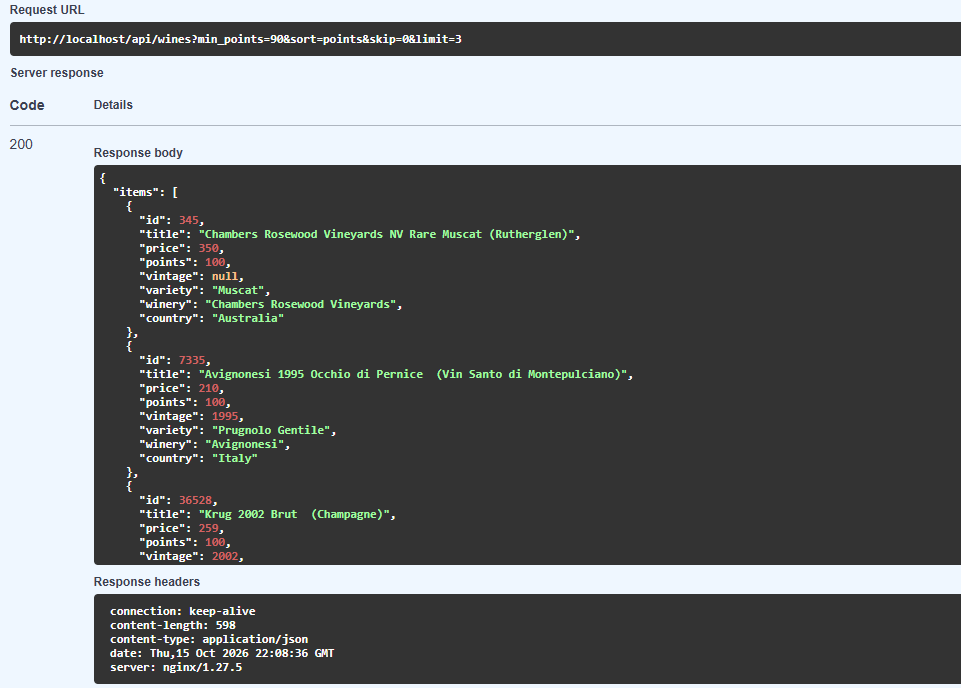
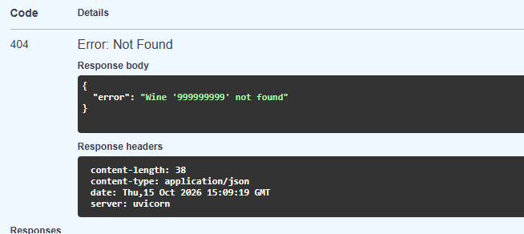
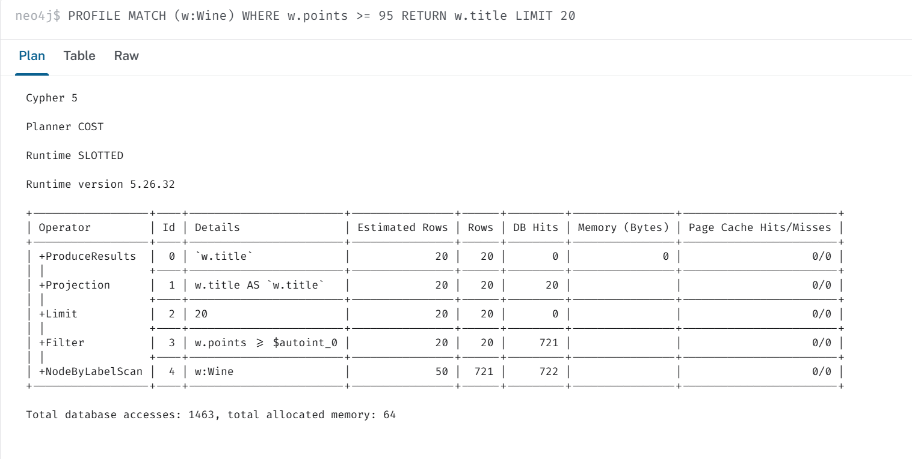
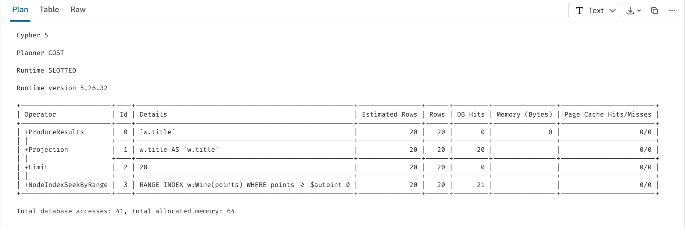

# Wine Explorer: a graph-backed sommelier

[](https://github.com/bhavika-chandru/wine-graph/actions/workflows/lint.yml) [](https://github.com/bhavika-chandru/wine-graph/actions/workflows/test.yml) [](https://github.com/bhavika-chandru/wine-graph/actions/workflows/docker.yml)

Wine Explorer answers questions about wines through the connections between them: wines that share tasting notes, regions and grapes, best-value picks, region profiles, taster bias, food pairings, flavour families, and free-form questions in plain English that are translated to Cypher.

Built with **Neo4j 5 + Graph Data Science**, **FastAPI**, an **NL→Cypher** agent with guardrails, and **Docker Compose** (Neo4j, API, Nginx).

**Contents:** [Quick start](#quick-start) · [Architecture](#architecture) · [Data sources](#data-sources) · [Graph model](#graph-model) · [API](#api) · [NL→Cypher](#nlcypher-agent) · [Graph Data Science](#graph-data-science-and-ml) · [Performance](#performance) · [Tests and quality](#tests-and-quality) · [Makefile](#makefile) · [Anti-genericity appendix](#anti-genericity-appendix) · [Team](#team)

---

## Quick start

Requirements: Docker Desktop with at least 4 GB of memory, Python 3.11+, `make` (on Windows, use WSL Ubuntu).

```bash
git clone https://github.com/bhavika-chandru/wine-graph.git
cd wine-graph
cp .env.example .env          # fill in passwords and API_KEY; .env is never committed
make install                  # .venv + dependencies
make docker-run               # neo4j + api + nginx
make seed                     # load both datasets
make gds                      # similarity, flavour families, embeddings, classifier
```

Open **http://localhost/docs** for the interactive API (Swagger), served through Nginx.

`POST /api/ask` needs the `API_KEY` from `.env` in an `X-API-Key` header; without it the API answers 401.

Pre-built API image (pushed by GitHub Actions on every merge to `main`): `ghcr.io/bhavika-chandru/wine-graph-api:latest`. To use it instead of building locally:

```bash
API_IMAGE=ghcr.io/bhavika-chandru/wine-graph-api:latest docker compose up -d --no-build
```

---

## Architecture



| Service | Image | Port | Role |
|---|---|---|---|
| `nginx` | nginx:1.27-alpine | 80 (public) | Reverse proxy, body-size limit, rate limit on `/api/ask` |
| `api` | built from `Dockerfile` | 8000 (internal only) | FastAPI, read-only Neo4j client |
| `neo4j` | neo4j:5 + GDS plugin | 7474 / 7687 | Graph database |

The classifier file is mounted into the API container (`./models:/srv/models:ro`), so retraining does not require rebuilding the image.

---

## Data sources

Two distinct sources, joined at the level of shared dimensions (variety, country, region) rather than wine by wine:

| Source | What it provides | Access |
|---|---|---|
| **WineEnthusiast reviews** (Kaggle, zynicide, `winemag-data-130k-v2.csv`) | ~130k expert reviews: points, price, taster, region hierarchy, descriptions | Kaggle download |
| **X-Wines** (Azambuja, Morais, Filipe, 2023) | Wine type, body, acidity, food pairings, crowd ratings | GitHub, slim version |

> Azambuja, R. X., Morais, A. J., & Filipe, V. (2023). X-Wines: A Wine Dataset for Recommender Systems and Machine Learning. *Big Data and Cognitive Computing*, 7(1), 20. https://doi.org/10.3390/bdcc7010020

**ETL notes** (`make seed`, numbers from the last run)

- 129,971 rows read. 9,979 exact duplicate reviews (same title and description) and 63 rows without a country or province are dropped, leaving **119,929 wines**.
- `Wine.id` is the CSV row id. 19,501 wines have no `region_1` and are linked straight to their province. 8,391 have no price (kept; they never match a price filter). The vintage is the first year in the title; 4,283 have none (mostly non-vintage sparkling).
- Descriptors: 121 tasting terms found in the reviews, from a fixed vocabulary of about 150, with synonyms merged ("earthy" -> earth, "cassis" -> blackcurrant). 1,857 reviews contain none.
- X-Wines is joined on grape name ("Syrah/Shiraz" matches either): 1,007 wines match 78 of the 701 varieties and give 504 `PAIRS_WITH` (a food is kept when at least 25% of that variety's X-Wines wines list it), plus the typical type, body, acidity and average crowd rating. Varieties with fewer than 3 X-Wines wines get no pairings. These 78 varieties cover 74,867 wines (62%), so `/api/pairings` can draw on most of the catalogue.
- 19 tasters; 95,012 reviews name their taster.
- Known limitation: descriptors are matched word by word, so a few terms can be read out of context ("orange" can be the colour of an orange wine, "cream" can come from "cream sherry"). Very common terms are left out of similarity and styles by `make gds` anyway.

---

## Graph model



The same model as an entity-relationship view, with keys and cardinalities:



Diagram sources (Graphviz) are in `docs/diagrams/`; regenerate with `dot -Tpng -Gdpi=150 docs/diagrams/schema.dot -o docs/schema.png`.

```
(:Wine {id, title, price, points, vintage, description})
(:Wine)-[:MADE_BY]->(:Winery)
(:Wine)-[:OF_VARIETY]->(:Variety)-[:PAIRS_WITH {weight}]->(:Food)
(:Wine)-[:FROM]->(:Region)-[:IN]->(:Province)-[:IN]->(:Country)
(:Wine)-[:FROM]->(:Province)          // when the review has no region_1
(:Taster)-[:REVIEWED]->(:Wine)
(:Wine)-[:HAS_NOTE]->(:Descriptor)
```

The exact property names and types agreed between ETL, API and GDS are in [docs/contracts.md](docs/contracts.md).

**Node or property?** A field becomes a node when we traverse through it, group by it, or share it across many wines (variety, winery, region hierarchy, taster, descriptor, food). Numbers we only filter or sort on stay properties (price, points, vintage).

**Rejected alternatives** (each needs a query that justifies it, and these did not have one):
1. A separate `Review` node: each wine has exactly one review in the source data, so it adds a hop and doubles the node count for no new query.
2. Precomputed `SIMILAR_TO` between all pairs of wines: millions of edges that go stale. GDS writes only the top-k neighbours per wine.
3. Variety, region and country as properties only: no rollups, no region profiles, no traversal-based similarity.
4. Matching individual wines across the two datasets: names and vintages differ, and fuzzy matching would be hard to defend.
5. LLM-based descriptor extraction: costly and non-deterministic. A fixed keyword vocabulary is used instead.

**Three awkward parts of the real data, handled in the model:**
- *Ragged hierarchy:* 19,501 reviews (16%) have no `region_1`, so those wines link straight to their Province. Queries reach the country with `-[:FROM]->()-[:IN*1..2]->(:Country)`, which works for both shapes.
- *Region key:* region names repeat across provinces, so a Region is identified by `(name, province)`; `/api/regions/{name}/profile` answers 409 with the candidate provinces when a name is ambiguous.
- *Supernodes:* "fruit" appears in 38% of reviews. `make gds` marks descriptors on more than 20% of wines as `common` and leaves them out of similarity and flavour families; otherwise every wine would look similar to every other.

---

## API

| Method | Path | Purpose | Technique |
|---|---|---|---|
| GET | `/health` | API + Neo4j liveness (200 / 503) | Driver connectivity check |
| GET | `/api/wines` | Filtered, sorted list | Query built from fixed clauses, range indexes |
| GET | `/api/wines/value` | Best points per price above a quality floor | Range filter + computed score |
| GET | `/api/wines/{id}` | Wine with location chain, taster and notes | Pattern comprehensions |
| GET | `/api/wines/{id}/similar` | Similar wines (`?max_price=` for cheaper ones) | **GDS Node Similarity**, Cypher Jaccard fallback |
| GET | `/api/wines/{id}/predicted-tier` | Quality tier from graph embeddings | **FastRP + scikit-learn** |
| GET | `/api/regions/{name}/profile` | Varieties, averages, typical notes | Hierarchy + `CALL {}` subqueries |
| GET | `/api/tasters/{name}/bias` | Taster vs other tasters, per variety | Aggregation + correlated subquery |
| GET | `/api/pairings?food=` | Wines for a food | Food ← Variety ← Wine (joins both sources) |
| GET | `/api/styles`, `/api/styles/{id}` | Flavour families | **GDS Louvain** |
| POST | `/api/ask` | Natural-language question | NL→Cypher agent + guardrails |

```bash
curl "http://localhost/api/wines?variety=Riesling&min_points=92&max_price=40&limit=5"
curl "http://localhost/api/wines/123/similar?max_price=25"
curl "http://localhost/api/regions/Napa%20Valley/profile?province=California"
curl -X POST http://localhost/api/ask -H "Content-Type: application/json" \
     -H "X-API-Key: $API_KEY" -d '{"question": "Best value Riesling under 20 dollars"}'
```

**Errors.** 400 query rejected by a guardrail (full body kept) · 401 missing API key on `/api/ask` · 404 unknown wine, region, taster, food or style · 409 region name in several provinces (body lists `candidates`) · 422 invalid parameters · 429 rate limit (Nginx) · 503 database down or GDS results not computed · 504 query timeout.

**Pagination.** Every list takes `skip` and `limit` (max 100) and returns `has_more`, computed by fetching `limit + 1` rows instead of running a second `COUNT` query.

Interactive docs are served at `/docs` (Swagger UI).



<details>
<summary>Example responses: a filtered list (200) and an unknown wine (404)</summary>

`GET /api/wines?min_points=90&limit=3` on the real data, through Nginx (note `server: nginx` in the response headers):



`GET /api/wines/999999999`: a clean JSON error, no stack trace:



</details>

Design decisions behind the API (parameterised queries, read-only transactions, error mapping, precomputed GDS results, the value formula) are explained in [docs/backend.md](docs/backend.md).

---

## NL→Cypher agent

Code: `app/agent/` (`pipeline.py`, `guardrails.py`, `prompts.py`, `llm.py`). Any OpenAI-compatible chat endpoint works: set `LLM_API_URL`, `LLM_API_KEY` and `LLM_MODEL` in `.env` (we used Groq with `openai/gpt-oss-120b`; a local Ollama model also works, without a key). Without them, `/api/ask` answers 503 and the rest of the API is unaffected.

Pipeline: scope check → entity grounding (exact names of countries, provinces, regions, grapes, critics, notes and foods looked up in the graph and given to the model) → generation (schema + few-shot, temperature 0) → static validation → `EXPLAIN` check with one retry → read-only execution → summary written only from the returned rows.

| Failure | Detection | Handling |
|---|---|---|
| Question asking to change data ('delete ...', 'drop ...') | Keyword check before any model call | Rejected (HTTP 400) |
| Write or admin clause (`CREATE`, `SET`, `DELETE`, `CALL` ...) in the generated query | Blocklist | Rejected (HTTP 400), no retry |
| Off-topic question | The model answers `OUT_OF_SCOPE` | Rejected (HTTP 400) |
| Unknown label, relationship or property | Whitelist | One retry with the problem, then rejected (never executed) |
| Unbounded path, missing `LIMIT` | Static check | Bounded / `LIMIT` injected |
| Syntax error | `EXPLAIN` | One retry with the error, then 400 |
| Hallucinated answer | Summary built from rows only | `provenance` marks rows as *verified (database)* and summary as *AI-generated* |
| Everything above fails | Read transaction + timeout | Neo4j refuses writes (verified by `tests/test_queries_live.py`) |

**Prompt design:** the system prompt holds the schema (with the ragged place hierarchy spelled out), the rules, and 7 worked examples. The examples deliberately differ from the evaluation questions.

**Evaluation** (`make eval`, 20 questions in `tests/eval/nl_questions.json`, full table in [docs/nl_eval.md](docs/nl_eval.md)). Each answerable question has a hand-written gold query; an answer counts as correct when the gold values appear in the agent's rows (numbers within rounding).

| Metric | Result |
|---|---|
| Valid query executed | 15/15 |
| Correct answer | 15/15 |
| Correctly rejected (2 write requests, 1 prompt injection, 1 off-topic, 1 admin request) | 5/5 |

Honest caveats: 20 questions is a small set. The first run scored 13/15. One failure was our scoring (rounding twice); the other was real: the model matched a *region named* Oregon instead of wines *in* the province. We then added a province example to the prompt (Burgundy, not Oregon), so the second run is not fully independent of the first.

---

## Graph Data Science and ML

Results of `make gds` on the full data (119,929 wines, 390 s). Details and settings are in `scripts/gds_setup.py`.

| Step | Projection | Settings | Result | Used by |
|---|---|---|---|---|
| Supernode filter | none | descriptors on more than 20% of wines get `common = true` | only "fruit" (38% of wines) | similarity and styles |
| Node Similarity (Jaccard) | `wine_notes`: Wine → Descriptor, common descriptors left out | top 10 per wine, cutoff 0.1 | 1,149,750 `SIMILAR_TO` for 114,975 wines | `/api/wines/{id}/similar` |
| Louvain | `note_pairs`: descriptor pairs that meet at least 3 times and 1.2× more often than chance, weighted by lift | weighted, consecutive ids | 3 flavour families, modularity 0.394 | `/api/styles` |
| FastRP | `wine_embed`: Wine, Descriptor, Variety, Region, Province, Winery (undirected) | 64 dims, iteration weights [0, 1, 1], seed 42 | 119,929 `Wine.fastrp` | `/api/wines/{id}/predicted-tier` |
| Logistic regression | FastRP vectors only: points and price are not inputs | balanced class weights, 80/20 stratified split | table below | same |

**The 3 flavour families** (most used notes first). Louvain only sees which notes appear together, never the grape or colour, yet the families match recognisable wine styles:
- Style 0, fresh and white: apple, toast, citrus, mineral, peach, floral
- Style 1, red fruit and earth (Pinot Noir-like): cherry, herb, raspberry, earth, strawberry, clove
- Style 2, dark fruit and oak (Cabernet-like): spice, oak, blackberry, plum, vanilla, black cherry

**Why lift for Louvain:** weighting pairs by raw co-occurrence lets the most popular notes link everything into one community. Lift keeps only pairs that meet more often than their popularity predicts, which is what a flavour family is.

**Classifier** (`high` = 90 points or more):

| Model | Accuracy | Macro F1 |
|---|---|---|
| Always predict the majority tier | 0.620 | 0.383 |
| Logistic regression on FastRP | 0.599 | 0.591 |

The tiers are imbalanced (62% `standard`), so accuracy is misleading: always answering `standard` already scores 0.620. Macro F1 weighs both tiers equally. The model reaches 0.591 against 0.383 for the baseline, so a wine's neighbourhood (its notes, grape, place and producer) carries real information about its quality, but far from enough to replace the critic's score.

PageRank is deliberately not used: it measures endorsement through directed links, which a wine–attribute graph does not have.

---

## Performance

Indexes give the query its starting point; after that, traversal follows relationships directly (index-free adjacency), so its cost depends on the degree of the nodes touched, not on the total size of the graph.

Measured with `make bench` on 100,000 synthetic wines (`make bench-data`, same shape as the real data), median of 10 runs after 2 warm-up runs:

| Case | Before | After | Speed-up | db hits |
|---|---|---|---|---|
| Range filter: no index vs range index | 22.6 ms | 3.1 ms | ×7.3 | 202,503 → 123 |
| Optional filters: `$x IS NULL OR` vs needed clauses only | 46.3 ms | 36.3 ms | ×1.3 | 278,248 → 140,426 |
| Wine detail: OPTIONAL MATCH chain vs pattern comprehensions | 3.6 ms | 7.6 ms | ×0.5 | 83 → 113 |
| Pagination: full result vs `SKIP/LIMIT` | 1,734 ms | 6.1 ms | ×285 | 272,404 → 61 |

Measured again on the **real data** (119,929 wines, in the Docker Compose Neo4j), same method:

| Case | Before | After | Speed-up | db hits |
|---|---|---|---|---|
| Range filter: no index vs range index | 32.1 ms | 7.4 ms | ×4.3 | 242,473 → 1,345 |
| Optional filters: `$x IS NULL OR` vs needed clauses only | 54.9 ms | 9.1 ms | ×6.0 | 317,731 → 6,731 |
| Wine detail: OPTIONAL MATCH chain vs pattern comprehensions | 3.2 ms | 3.0 ms | ×1.1 | 146 → 189 |
| Pagination: full result vs `SKIP/LIMIT` | 2,285.6 ms | 3.4 ms | ×675.1 | 323,536 → 61 |

What the numbers say:
- **Indexes and pagination** give the large gains. Without the range index Neo4j reads every Wine node; with it, the plan switches from `NodeByLabelScan` to `NodeIndexSeekByRange`.
- **Catch-all filters** (`$x IS NULL OR w.points >= $x`) cannot be answered from an index, so the list query is built from only the clauses that are set. On the synthetic data the gain was modest (×1.3) because the planner chose the price index; on the real data it is ×6.
- **Pattern comprehensions** are not faster for a single wine (slower on the synthetic data, equal on the real data). They are kept for correctness: they never duplicate rows, so no `collect()` or `DISTINCT` is needed.

Full plans per case, on the real data: [docs/benchmarks.md](docs/benchmarks.md).

| Without index: `NodeByLabelScan` | With range index: `NodeIndexSeekByRange` |
|---|---|
|  |  |

---

## Tests and quality

| Command | What it runs |
|---|---|
| `make test` | Unit and API tests with a fake database (coverage ≥ 60%, currently ~95%) |
| `make test-db` | Every endpoint's Cypher against a real Neo4j loaded with `tests/fixtures/seed.cypher` (wipes that database) |
| `make test-integration` | Container health checks through Nginx (needs `make docker-run`) |
| `make lint` | pylint with the course `.pylintrc` (must stay ≥ 9.5, currently 10.00) |

The test dataset covers the awkward parts of the real data on purpose: a wine with no region, a region name shared by two provinces, a wine with no price, and a wine without GDS results (to test the similarity fallback).

---

## Makefile

| Command | Description |
|---|---|
| `make help` | List all commands |
| `make install` | Create `.venv` and install dependencies |
| `make run` | Run the API locally with auto-reload |
| `make docker-build` / `make docker-run` / `make docker-down` | Build the image, start or stop the stack |
| `make test` / `make test-db` / `make test-integration` | Tests (see above) |
| `make lint` / `make format` | pylint / black |
| `make seed` | ETL for both sources |
| `make gds` | Projections, algorithms, embeddings and classifier |
| `make eval` | NL→Cypher evaluation |
| `make bench-data` / `make bench` | Synthetic data for benchmarks / before-after report |
| `make tree` / `make clean` | Project structure / remove caches |

---

## Anti-genericity appendix

We gave a fresh ChatGPT chat one line, *"Design a Neo4j graph schema for a wine recommendation app using a wine reviews dataset."*, and compared its answer with what we built. The full answer is in [docs/appendix/naive_schema_chatgpt.pdf](docs/appendix/naive_schema_chatgpt.pdf).

In short, it proposed `Wine`, `Winery`, `Region`, `Country`, `Grape`, `Review`, `TastingNote`, `Style` and `User` nodes, a `User` layer with `RATED`/`LIKED`/`WANTS_TO_TRY`, and a recommendation query that scores candidates by shared grape (×3) and shared region (×2). The schema is reasonable, but it is written for any wine dataset, not for this one.

| Naive AI schema | Our schema | Why |
|---|---|---|
| `TastingNote` nodes listed, but never loaded ("add flavor-note extraction later"); similarity = shared grape + shared region | `Descriptor` nodes extracted in the ETL, `HAS_NOTE`, GDS Node Similarity written as `SIMILAR_TO {score}` | The review text is the richest field in the data. Two Cabernets from Napa are not similar just because they share a grape and a region; shared descriptors measure what the critic actually tasted |
| No handling of very common notes | Supernode filtering on descriptors | Very common notes ("fruit") connect to most wines and would make every wine similar to every other |
| `Region {name: row.province}`: province loaded as region, keyed by name only; `Region → Country` | `Region` keyed by `(name, province)`; ragged `Region → Province → Country`, or `Wine → Province` when `region_1` is empty | The dataset has three levels (`country`, `province`, `region_1`) and `region_1` is often missing. Region names repeat across provinces; the API answers 409 with the candidates instead of merging them |
| `MERGE (:Winery {name})` | `Winery` keyed by `(name, country)` | Different producers in different countries can share a name |
| Separate `Review` node, plus derived `avgPoints` / `reviewCount` on `Wine` to refresh after each load | No `Review` node; `points` on `Wine`, `(:Taster)-[:REVIEWED]->(:Wine)` | Each row is one critic's tasting of one bottle, and the dataset has no wine identifier to group rows by. A `Review` node adds a hop and a derived property to keep in sync for no new query. Making the taster a node is what gives us the taster-bias insight |
| `User` layer (`RATED`, `LIKED`, `WANTS_TO_TRY`, `PREFERS`) | No users | The dataset has critics, not consumers. The ChatGPT answer itself says this layer cannot come from the data; we did not invent it |
| `Style` = red / white / rosé, set by hand | `Descriptor.style_id` from Louvain (flavour families) | Styles found in the graph structure, not a fixed label list |
| One source | Second source (X-Wines) joined on `Variety`, `(:Variety)-[:PAIRS_WITH {weight}]->(:Food)` | Food pairings are not in WineEnthusiast. The two sources cannot be matched wine by wine reliably, so they meet at the variety level |
| Indexes on `name`, `avgPoints`, `vintage`; the query filters `price <= $maxPrice` on every wine | Range indexes `wine_points` and `wine_price` only, measured with `PROFILE` (202,503 → 123 db hits); optional filters added only when given | Indexes chosen from the queries we actually run. A filter written as `price <= $maxPrice` silently drops wines with no price; ours only applies it when the caller asks |

**A decision we changed from the original brief:** the similarity endpoint first fell back to a Cypher Jaccard whenever GDS returned too few neighbours. After review, the fallback only runs when a wine has no `SIMILAR_TO` at all, so one response never mixes scores from two different methods.

---

## Team

Contributions on `main` from GitHub Insights → Contributors, before this last PR (29 commits in total).
Every change went through a pull request with at least one review from another member.

| Member | Role | What they built | Commits | Lines added | Merged PRs |
|---|---|---|---|---|---|
| Bhavika Chandru (`bhavika-chandru`) | Backend, API, performance, team lead | FastAPI app, every endpoint's Cypher, error handling, read-only client, Nginx config, Dockerfile, live Cypher tests, benchmarks and PROFILE analysis, README | 14 (48%) | 3,863 (60%) | [list](https://github.com/bhavika-chandru/wine-graph/pulls?q=is%3Apr+is%3Amerged+author%3Abhavika-chandru) |
| Ditri (`ditricollaku`) | AI agent and Graph Data Science | GDS pipeline (Node Similarity, lift-weighted Louvain, FastRP, tier classifier), NL→Cypher agent with guardrails and its evaluation, demo notebook | 8 (28%) | 1,757 (28%) | [list](https://github.com/bhavika-chandru/wine-graph/pulls?q=is%3Apr+is%3Amerged+author%3Aditricollaku) |
| Yash (`yashmadori`) | Data and infrastructure | ETL for both datasets, constraints and indexes, Docker Compose stack, GitHub Actions (lint, tests, image push), diagrams | 7 (24%) | 768 (12%) | [list](https://github.com/bhavika-chandru/wine-graph/pulls?q=is%3Apr+is%3Amerged+author%3Ayashmadori) |

## Use of AI tools

- **Claude (Anthropic)** was used throughout as a coding assistant: drafting code, tests and README text, suggesting review points, and debugging errors from our terminal output. Every draft was run on our machines against the real data, and changed when it failed (for example the memory-safe wipe in the ETL, the province example in the agent prompt, the Nginx health check). Review points were checked against the code before being posted.
- **ChatGPT** produced the naive schema used in the anti-genericity appendix, from a one-line prompt in a fresh chat, so we could compare it with ours.
- **Groq (`openai/gpt-oss-120b`)** is part of the product: it writes the Cypher and the summary for `/api/ask`. Its output is never trusted directly: guardrails, `EXPLAIN` and read-only transactions sit around it, and the summary is marked as AI-generated.
- All design decisions (schema, keys, which algorithms, what to measure) were discussed and decided by the team, and each of us can explain the parts we own.
